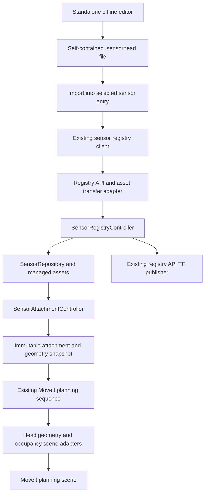

# Spot sensor head editor design

Design status: proposed subproject, revised 11 October 2026 for option 1.

Build a standalone sensor-head editor with Spot's gripper preloaded as a fixed
reference. A user imports an STL or builds a mount from simple shapes, positions
it at the lower-jaw interface, and defines the sensor tip's position and direction.
The editor exports one self-contained `.sensorhead` file containing the collision
mesh, its placement, and the sensor-tip transform. Importing that file through the
existing Spot UI updates the currently selected sensor entry's geometry and probe
pose together. The Spot application supplies TF and the MoveIt attachment.

The editor requires no ROS installation, running robot software, or connection to
Spot. Users do not edit URDF, configure robot joints, or manage ROS frames. This
design selects option 1: an attached mesh with transforms. Dimension/clipboard
imports and regeneration of the complete head mesh are outside the workflow.

This is a moderate, bounded implementation project. Mesh display and picking have
established library support. The substantial work is a dependable mounting
workflow, replacement of the original jaw geometry, and synchronization between
the saved definition, physical attachment state, TF, and MoveIt.

## Product scope

The first release supports one rigid sensor head replacing a verified portion of
the fixed lower gripper jaw, with one sensing frame per sensor definition. The
preloaded wrist and remaining gripper are a locked visual reference. The user can
orbit the view, but cannot edit the robot's kinematics, joint limits, or permanent
geometry.

Include STL import, explicit unit selection, guided head placement, tip and
direction selection, box and cylinder creation, collision preview, undo and redo,
and export/reopen of the head file. Both imported and shape-built mounts produce
the same mesh-based output. The existing application gains an import action and
review preview for the selected sensor entry; it retains ownership of acquisition
channels, sensor identity, persistence, and physical attachment confirmation.

Defer CAD solid modeling, arbitrary robot editing, articulated attachments,
automatic scanning, automatic physical calibration, and multiple independently
moving probes. Precise measured dimensions and offsets are supported. The head
file is the normal exchange format.

## User workflow

| Step | User action | Behavior |
| --- | --- | --- |
| Open editor | Launch the standalone editor | Open a draft with a locked wrist, remaining gripper, and highlighted mounting interface from the bundled reference template. Provide front, side, top, and perspective views. |
| Import or build | Drop an STL, or choose **Add box** / **Add cylinder** | Display the head in a distinct color. Ask for STL units and show its width, height, and length in millimetres. Primitive dimensions use millimetres. |
| Mount | Choose the supplied lower-jaw template and align the head | Use the template's known mounting datum. Provide guided reference selection for an arbitrary STL and constrained drag handles for adjustment. |
| Mark sensor | Click the sensing point and indicate the sensing face or direction | Show the point and a clear approach arrow. Allow **Flip direction**, roll adjustment, and a measured offset from the picked surface. |
| Review | Inspect the head and collision envelope from several views | Show dimensions, approach arrow, collision coverage, and any unresolved import or placement issue. |
| Export file | Select **Export head** and choose a destination | Write one validated `.sensorhead` file containing the mesh and both transforms. Exclude the Spot reference geometry. The file can be reopened in the editor. |
| Import into Spot UI | Select the intended sensor entry and choose **Import head file** | Preview dimensions, placement, and tip pose against the application's compatible reference. Apply geometry and probe pose together after validation, preserving sensor identity and acquisition settings. Existing mutation guards still apply. |
| Use | Select the configured sensor and confirm it is physically installed | Use the existing attachment workflow. Prepare the matching MoveIt scene before admitting the next plan. Importing alone does not confirm an installation. |

The default screen needs a 3D viewport, a short step panel, a few dimensions, and
Back, Next, Undo, Reset view, and Export controls. Keep frame names, quaternions,
collision message types, and file paths out of the normal workflow. Advanced
numeric placement remains available for precise adjustment. File pickers handle
export and import; users need not copy assets into a robot-specific folder.

### Mounting an arbitrary STL

An STL does not identify its units, mounting interface, or sensing point. Placing
it visually against Spot provides only an estimate. The editor must establish a
physical correspondence before offering a precise snap.

Provide two placement paths:

- **Template coordinates:** a head exported with the supplied mounting datum is
  positioned directly. Display the alignment for confirmation.
- **Guided alignment:** show three ordered, non-collinear reference locations on
  the mounting template and ask the user to select their corresponding locations
  on the imported head. Solve a rigid placement and report alignment mismatch in
  millimetres. Reject degenerate selections and substantial distance mismatch;
  do not silently stretch the head to make it fit. Hole-center or planar-feature
  snapping can improve selection after the basic workflow is proven.

Constrained dragging and numeric offsets refine this placement. Unit conversion
is separate from placement; scaling is disabled on the placement handles. A
head without identifiable mounting references can still be positioned manually,
but the interface must describe that placement as manually configured.

### Selecting the sensing frame

A clicked point supplies position only. Use a selected face or explicit arrow to
define local **+X toward the inspected surface**. Show an explicit flip control;
STL normals alone cannot establish the intended sensing direction.

Choose the remaining orientation from the mounting template's up direction,
projected perpendicular to +X, and expose a simple roll control. Reject a
degenerate up direction and ask the user to choose another reference. Preserve a
right-handed orthonormal frame. For a curved surface, let the user choose the
direction separately rather than depending on one small triangle's normal.

The sensing point may lie ahead of the imported housing. Allow a measured offset
along the approach arrow or numeric adjustment. Selecting the sensing frame must
not translate or rotate the collision geometry.

## Technology choice

Use **Python, PyQt5, VTK, and NumPy** for a separately packaged desktop application.
Python 3.10 and VTK 9.1 are the initial compatibility baseline established by the
current development environment. Declare and test the editor's own dependencies;
it must launch in an environment without ROS or the `fault_detector_spot` package.
The integration in the Spot application remains a separate component.

| Responsibility | Library or API | Reason |
| --- | --- | --- |
| Dialogs, steps, dimensions, undo | PyQt5; `QUndoStack` | Provides the standalone desktop workflow with familiar Qt tooling. |
| Embedded 3D view | VTK `QVTKRenderWindowInteractor` | Embeds a renderer directly in the Qt event loop. |
| STL and reference mesh loading | `vtkSTLReader`, `vtkOBJReader` | Loads imported heads and prepared, bundled Spot reference assets. |
| Surface picking | `vtkCellPicker` | Supplies an actual mesh intersection and its normal; restrict picking to the intended actor. |
| Placement interaction | `vtkBoxWidget2` and `vtkBoxRepresentation`, plus Qt numeric controls | Provides a rigid transform when scaling and face movement are disabled. A polished set of axis handles remains application UI work. |
| Geometry processing | VTK triangle, cleaning, normal, and feature-edge filters | Reuse the same mesh representation for display and structural checks. |
| Pose mathematics | Pure Python and NumPy | Keep unit conversion, frame construction, and rigid alignment independent of UI and ROS. |
| File export/import | JSON and ZIP from the Python standard library; VTK mesh writer | Produces one portable file with explicit transforms and embedded geometry. |
| Application persistence and robot integration | Existing YAML repository, `rclpy`, `tf2`, `moveit_msgs`, and `shape_msgs` | Used only by the Spot application to consume the file and extend the current registry and planning path. |

VTK documents [STL loading](https://vtk.org/doc/nightly/html/classvtkSTLReader.html),
[surface picking](https://vtk.org/doc/nightly/html/classvtkCellPicker.html), and
[Qt embedding](https://docs.vtk.org/en/latest/api/python/vtkmodules/vtkmodules.qt.QVTKRenderWindowInteractor.html).
Use APIs verified against the 9.1 baseline; current online documentation also
contains newer APIs.

Direct VTK avoids adding PyVista, pyvistaqt, or a browser bridge for this small
viewport. Keep rendering behind an adapter so this choice is replaceable.
Trimesh can be considered later for a demonstrated mesh-processing need; it is
not required for the first release. New C++ application code is unnecessary:
VTK performs rendering and mesh operations in its native implementation.

Ship the fixed reference assets and their versioned mounting datum with the
editor. Prepare these assets from the supported robot model during development;
the editor does not need to load a running robot's URDF or fetch assets over ROS.
Reference updates ship as compatible editor/template releases.

Keep rendering on the Qt thread and expensive import/validation work off it;
workers return immutable results rather than modifying rendered actors.
The Spot application's importer must not require the standalone editor process to
be running. Load any 3D preview dependencies on demand in the existing UI.

Pick against the original mesh even when display geometry is simplified. Check
pick success before using returned coordinates or normals. Explicitly convert
VTK's local-Y cylinder axis to the editor's documented shape-axis convention and
test it. Cylinders are tessellated into the exported mesh, not sent as ROS primitives.
Selecting an entire planar face also needs application logic to group coplanar
STL triangles because an STL contains no CAD face identities.

## Existing architecture and new responsibilities

Keep the editor independent. Extend the existing sensor subsystem to consume its
files rather than create a parallel registry or an editor-to-ROS connection.



| Owner | Responsibility |
| --- | --- |
| Standalone editor | Reference display, shape authoring, picking, measured dimensions, placement, tip configuration, undo, file export and reopening. No ROS imports or robot commands. |
| Editor domain and file-format module | Unit conversion, rigid alignment, probe-frame construction, mesh preparation, and the versioned portable contract. No Qt actors or ROS messages in data models. |
| UI under `ui/sensor` | File selection, import preview, target-entry selection, and import intent. No direct TF or planning-scene writes. |
| Application domain and import adapter | Validate the package and compatibility, convert to existing pose/domain types, and construct one proposed update for the selected sensor entry. Reuse existing application geometry helpers. |
| `SensorRegistryController` | Validate and save geometry and probe pose atomically under existing mutation guards. |
| `SensorRepository` | Store definitions and managed assets, including revisions and checksums. |
| Registry ROS API and client | Convert typed data, transfer assets, publish definitions and the existing sensor TF. |
| `SensorAttachmentController` | Own physical selection, confirmation, revision, and motion reservations. |
| MoveIt planner and scene adapters | Apply and verify the confirmed head geometry in the existing serialized planning sequence. |

The portable file-format module can be shared as a small ROS-free dependency;
the standalone editor must not import the robot application to obtain its models.
The application consumes completed geometry and transforms rather than repeating
the editor's authoring workflow.

An editor draft or exported file describes a head, not physical attachment state.
Opening the editor never moves Spot. Any future calibration movement must pass
through CommandController, ROS command transport, the Behavior Tree, and the
existing execution components.

## Frame and data contract

Retain `SensorDefinition.hand_to_probe` as the authoritative persistent probe
pose and `hand -> <sensor_id>_probe` as the public TF. Geometry has its own
placement relative to `hand`. A separate persisted head-to-probe pose must not
compete with the existing hand-to-probe field.

During editing, convert picks from the viewport into the imported geometry frame.
For a head placement `T_hand_geometry` and a picked local frame
`T_geometry_probe`, compute:

```text
T_hand_probe = T_hand_geometry * T_geometry_probe
```

Export the result as `hand_to_probe`. Reconstruct the local marker when reopening
with the inverse head placement. If a draft head is moved, carry its marker with
it and recompute the result; changing only the tip leaves geometry unchanged.
The importer copies the exported probe pose into the existing authoritative field.
Apply mesh placement once: normalize source units into local mesh coordinates,
then store placement separately rather than also baking it into the vertices.
Bake individual shape or source-piece poses into that shared geometry frame before
writing the final mesh; retain `hand_to_geometry` as its external placement.

### Portable head file

Use `.sensorhead` as an application-specific ZIP container built from standard
files. Its runtime payload is `manifest.json` and `collision.stl`. This editor's
exports also retain the authoring data needed for further editing: primitive
dimensions and poses, and original source meshes used for envelope construction
or tip picking. Reopening an exported file must preserve those editing abilities.
Every referenced asset is embedded; the package never depends on a path on the
author's computer.

Authoring data is optional in the portable contract and ignored by the robot
importer. The final collision mesh and manifest poses are authoritative for robot
integration; editor-only data must not override them. A file without authoring
data can still reopen as a placed mesh with its tip marker.

The manifest contains these conceptual fields:

| Field | Purpose |
| --- | --- |
| `schema_version` | Version of the portable file contract. Unsupported versions produce an actionable import error. |
| `display_name` | Human-readable head label for preview; does not replace the selected sensor's identity. |
| `reference_frame` | The supported template's `hand` datum, not an arbitrary TF name supplied by the user. |
| `mounting_template_id`, template revision, and reference-model fingerprint | Identify the mounting datum and compatible replaceable-jaw configuration. |
| `units` | Explicitly `m` for all exported geometry and translation values; STL alone has no unit metadata. |
| `hand_to_geometry` | Rigid placement of the collision mesh relative to the reference hand. |
| `hand_to_probe` | Authoritative sensing pose relative to the same hand, independent of mesh tessellation. |
| `collision_mesh` | Embedded mesh path, format, byte count, and content hash. |
| `clearance_m` and approximation method | Describe clearance already incorporated into the exported mesh; the importer must not apply it again. |
| `configuration_method` | For example, manual dimensions or CAD alignment. Do not label an unmeasured model as physically calibrated. |

Use metres internally and millimetres in user controls. Store quaternions in the
existing x, y, z, w convention, finite and normalized. Preserve full numeric
precision in JSON; display rounding must not modify the stored pose. Record
source STL units as provenance after converting them once.

The file contains neither a registry sensor ID nor acquisition-channel settings.
The import target is the entry selected in the Spot UI. The backend allocates a
new definition revision when it accepts the combined geometry/pose update; an
exported file does not control registry revision numbers or allowed-contact links.

Extend the persistent definition with `head_geometry` containing the compatible
template identity, managed collision asset reference, `hand_to_geometry`, and
provenance, alongside the existing `hand_to_probe`. Freeze the definition revision
and collision content hash in `MotionAttachmentSnapshot` alongside the existing
attachment revision. Both the tip and collision volume belong to that snapshot.

### Import, persistence, and remote operation

The current Spot implementation saves imported geometry and the probe pose
together through **Save Sensor Mount**. It uses a bounded `UploadSensorMesh`
service (48 KiB per request) to stage a content-addressed asset, followed by the
existing add/update service carrying geometry metadata. The backend checks the
completed mesh and referenced asset before atomically writing the sensor YAML.
The UI retains imported bytes until save succeeds, displays upload progress,
and restores saved geometry metadata when editing a mount. It does not depend
on a shared filesystem. Generated ROS message serialization, failure paths, and
storage have offline coverage; deployed DDS transfer remains to be validated.

Asset download for runtime consumers, stale-definition revision checks, 3D import
preview, and MoveIt attachment/snapshot synchronization remain future work. The
requirements below describe that complete target workflow. Saving an unverified
mounting template records its provenance and does not certify physical alignment.

The import dialog previews the complete proposed result before applying it.
Validate archive paths, expanded size and entry limits, supported schema, units,
finite transforms, hashes, mesh validity, and reference compatibility. Reject path
traversal and references outside the package. File parsing does not execute code.
Preserve the existing definition if any validation or transfer step fails.

Preserve the current sensor YAML location under
`$ROS_HOME/fault_detector_spot/sensors`. Place normalized meshes in a managed
`assets` subdirectory with content-based identifiers. A definition references
relative managed paths, never the original file in Downloads. Write validated
assets first, then atomically replace the YAML manifest with both the geometry and
probe pose. Preserve the selected entry's ID, acquisition channels, and unrelated
settings. Do not update text fields independently or leave a new pose paired with
old geometry after a failed import.

The UI is remote-capable. An STL path on the UI machine cannot be assumed to exist
on the backend. Add bounded asset upload/download at that real ROS boundary,
including content hash, byte count, format, progress, and explicit failure. Use
chunked transfer for assets exceeding the agreed message limit; prototype limits
against the deployed DDS configuration before choosing the final interfaces.
Registry updates carry metadata and asset IDs, not repeated mesh payloads.

The backend owns the supported mounting-template/model identities. Validate the
file against those identities at import and again at activation. The UI's preview
uses a compatible reference asset, obtained through the proposed UI/backend asset
boundary if necessary; this is separate from the offline editor's bundled assets.
An import includes the expected target definition revision so a stale dialog
cannot overwrite a newer definition silently.

Extend `SensorDefinition.msg`, its adapters, and existing add/update services for
geometry metadata. Transfer assets before submitting the completed definition;
the backend rejects missing assets or hash mismatches and repeats authoritative
validation. Cache downloaded assets by hash for previews. The `.sensorhead` file
is the single supported user exchange path; ROS asset transfer is an internal
application transport concern.

The application API and execution components also cross a ROS process boundary.
Extend existing command/context transport with the reserved attachment revision,
definition revision, probe pose, and immutable geometry reference where required.
Execution resolves that exact geometry through the registry boundary and its content cache;
it must not infer the installed head from whichever definition or TF arrived last.
Inspect producers, semantic command models, ROS adapters, and execution consumers
together when extending this contract.

## Collision geometry policy

Visual shape and collision shape are distinct representations of the same head.
Show the collision shape as a translucent overlay. Cover the housing, mounting
bracket, and rigid protrusions that travel with the hand, including the probe.
Export only the added attachment; the preloaded wrist and remaining gripper are
reference geometry and must not become part of the attached mesh.

The runtime representation is always a triangle mesh. Imported STLs must satisfy
collision checks and a measured complexity limit. Boxes and cylinders are editor
authoring tools: triangulate them into the same mesh representation before export.
Multiple closed components may form one attachment; validate each component.
Solid-model Boolean operations are not required for the first release.

Offer an enclosing box or a small assembly of shapes when an STL is unavailable,
unsuitable, or unnecessarily detailed. Display that approximation for review and
export its triangulated surface. For curved primitives, choose tessellation that
encloses the specified solid within a documented approximation tolerance;
an inscribed polygon must not silently make a cylinder's collision volume smaller.

Do not silently decimate collision meshes: decimation can remove material from
the collision envelope. Display-only simplification is independent. Automatic
convex decomposition and guaranteed mesh offsetting belong to a later phase.

Implement clearance for primitives explicitly: enlarge box dimensions by twice
the margin; enlarge cylinder radius by the margin and length by twice the margin.
Apply primitive clearance before tessellation. An arbitrary imported triangle mesh
initially supports its nominal surface with zero additional margin, or a
conservative shape-built envelope with a margin. Disable unsupported mesh-margin
combinations. All supported clearance is baked into the exported collision mesh
exactly once; changing clearance never changes the tip transform. Do not describe
global mesh scaling as a uniform clearance shell or assume robot-link padding
inflates attached objects.

The environment toggle and per-command bypass retain their current semantics:
they change OctoMap collision relationships. Explicit scene objects and normal
self-collision rules remain in force. The new head follows the same policy.
Existing final probing segments continue using the existing occupancy bypass and
execution guard; this subproject does not redesign intended-contact behavior.

The backend's verified mounting template supplies narrowly defined allowed-contact
links for the attachment interface. Users do not need to configure an Allowed
Collision Matrix, and a file cannot request arbitrary collision exemptions.
Although the mount moves as part of the hand, it can still hit the forearm, body,
or moving finger. Keep those checks unless a specific contact has been verified
as part of the mounting interface; do not exempt the head from the entire robot.

## Replacing the original jaw in MoveIt

The current `arm_link_wr1` contains permanent wrist collision geometry plus
`front_jaw`, `middle_jaw`, and `jaw_tooth` mesh components. The moving finger is
separate. Identify the exact physically removed part before changing the model;
filenames alone do not establish which components disappear.

The baseline design is an exchangeable jaw slot:

1. Make a one-time robot-model change that separates the verified removable jaw
   from permanent collision geometry. Retain the wrist and remaining finger.
2. Provide the stock jaw as a built-in geometry profile for the confirmed
   no-sensor state. That state means the normal gripper is installed; an exposed
   interface with neither stock jaw nor head needs a separate explicit profile
   if that physical configuration will be supported.
3. Represent the installed stock jaw or sensor head as the single owned
   `AttachedCollisionObject` fixed to the existing `hand` link. Compose source
   meshes through the existing wrist-to-hand transform; do not duplicate its
   offset in the editor.
4. Swap this owned object through planning-scene diffs. Keep unrelated objects
   and collision rules intact. Removal of an old head must not leave it as an
   obstacle in the world.

This uses MoveIt's established
[attached-object and acknowledged scene-update APIs](https://moveit.picknik.ai/humble/doc/examples/planning_scene_ros_api/planning_scene_ros_api_tutorial.html).
The application adds geometry to the planning scene at runtime. It does not
rewrite and reload the complete robot URDF whenever a user saves a head. The
current launch reads the URDF when MoveIt starts; an attached object cannot
subtract collision shapes that remain embedded in that loaded robot model. The
replacement boundary is chosen once for the supported mounting template, not
edited by each head file.

The initial model change requires a normal deployment and restart to take effect.
Subsequent head changes use scene updates. The editor reference visuals must
likewise distinguish the removed lip; a combined visual mesh may need one-time
asset preparation. The standalone editor exports the attachment package only.

Changes to `spot_moveit_config` are a prerequisite outside the current default
edit scope. Their implementation needs explicit scope authorization. This design
does not authorize deployment, node restarts, or physical validation.

## Activation and synchronization

Keep the distinction between **file exported**, **definition imported**,
**physical attachment confirmed**, and **scene synchronized**. The last is derived
integration status, not a second authority for which head is attached. An offline
export cannot change the robot application; importing changes a stored definition,
and the existing selection/confirmation workflow determines physical attachment.

Extend the current planner sequence as follows:

1. Obtain a confirmed immutable attachment snapshot, including its definition
   revision, collision hash, and stock/custom geometry. Apply this to every
   MoveIt arm plan, including ordinary hand motions, not only probe commands.
2. Through the existing scene-update sequence, read the owned attached object and
   current collision policy. Compare actual geometry and placement with the
   expected snapshot rather than relying on a local cached “applied” flag.
3. Apply the required head replacement and occupancy policy. Await successful
   completion, then verify the owned scene object before requesting a plan.
4. Recheck the attachment/definition revisions before accepting the plan and
   immediately before dispatch. Keep the reservation effective throughout the
   operation so a head cannot change during execution.
5. On missing geometry, unknown update completion, a changed revision, or a
   MoveIt restart, refuse a new plan until the expected scene is synchronized.
   Startup must install the confirmed stock/custom profile before planning;
   there is no valid planning state with the removable jaw accidentally absent.

Use stable owned object IDs and idempotent updates. Serialize updates through the
existing planner, including cancellation and uncertain service completions. An
activation-triggered scene refresh, if added, uses that same sequence while idle.
External clients that modify the same scene require coordination; this design
does not make concurrent independent scene writers safe.

The UI-selected registry row is the import target; it does not necessarily mean
the physically selected head. Preserve the existing idle requirement and guards
against changing selected, pending, or reserved definitions. A user can preview a
file for an active head, but applying it must wait until the existing attachment
workflow permits editing
that entry. The importer must not silently switch physical selection or bypass
these guards. Legacy definitions without geometry remain readable and editable;
require geometry completion before authorizing geometry-aware MoveIt motion with
that physical sensor. Never treat a missing head model as an empty head.

The registry remains the only publisher of `hand -> <sensor_id>_probe`. Static TF
may remain in listeners after a definition is deleted; presence of that frame
does not prove the head is installed or even still registered. Use registry and
attachment state for admission, and retain the existing static-TF deletion
limitation. Do not introduce a competing URDF or editor TF publisher.

Static TF updates also arrive asynchronously. Existing consumers can retain an
old pose after a definition is edited and the same sensor ID is reselected.
Derive motion geometry from the reserved snapshot's probe pose wherever that
snapshot is available. Any remaining TF-based consumer must verify that its
hand-to-probe transform agrees with the reserved pose before admitting motion.
Matching attachment and scene revisions alone does not establish TF readiness.

## Accuracy and operating limits

The saved transform is a geometric configuration. Its physical accuracy depends
on STL scale, mounting references, manufacturing tolerances, assembly play, and
selection accuracy. Target **1 mm or better for the physical tip position relative
to the hand mounting datum**, verified by measurement on representative heads and
after remounting. This is a validation target, not an accuracy guarantee from a
mouse click or a detailed mesh, and does not establish absolute world/surface
accuracy of the robot.

Support measured dimensions, numerical tip offsets, stable mounting references,
and full-precision pose storage. Set a round-trip translation-error acceptance
threshold of 0.01 mm over the supported head-size range so serialization and
coordinate conversion consume a negligible part of the physical error budget.
Verify orientation separately: a correct tip position does not establish the
correct approach direction or roll. Define the angular tolerance from the intended
sensing operation and distance during release validation.

Show alignment residual and entered dimensions, but do not present fitting
residual as absolute calibration accuracy. Mesh detail improves collision shape
fidelity; it does not improve the accuracy of the separately stored probe pose.
Physical calibration can later refine that pose without moving the collision
envelope. Automatic calibration or a measurement-fixture workflow is not part of
the initial editor implementation.

The current occupancy map uses 5 cm voxels. Its sensing-mask padding is a separate
quantity from collision clearance. Verify attached-body self-filtering and stale
occupancy behavior before claiming complete integration; excessive filtering can
also hide nearby real obstacles.

The current native stow and preparation paths bypass MoveIt. Adding a head to the
planning scene therefore does not automatically protect those paths or provide
continuous runtime avoidance. Inventory them during implementation. A custom
head must not be advertised as supported for an unvalidated native motion;
gate that operation or supply an explicitly approved, separately validated
alternative before release. Keep existing execution guards intact.

## Delivery stages and acceptance

| Stage | Deliverable | Acceptance |
| --- | --- | --- |
| 1 Reference and library prototype | Standalone fixed-hand preview, one actual STL, units, surface picking, and marker orientation | Launches without ROS or the Spot application installed. Identify the real removable jaw and mounting references; version the prepared reference assets. |
| 2 Offline editor and file contract | Guided alignment, shapes, collision overlay, undo, `.sensorhead` export and reopen | A novice completes representative imported and shape-built heads using the guided UI. Both produce the same mesh/pose contract; the editor's exports preserve placement, sensing frame, primitive dimensions, and original source geometry on reopening. |
| 3 Registry import integration | Import preview, atomic geometry/pose update, versioned definitions, managed assets, remote transfer, existing TF publication | Import into the selected entry works across separate UI/backend filesystems and retains its identity/channels. Failed validation/transfer/save preserves the previous definition and mutation guards. |
| 4 MoveIt integration | Approved jaw-slot model change, stock/custom scene synchronization, attachment gating | Isolated scene tests cover swaps, collision policy, failures, cancellation, and stale revisions. No live robot required. |
| 5 Release validation | Novice usability session and approved physical checks | Measure the 1 mm hand-relative tip target, orientation, and remounting repeatability. Verify collision coverage, sensing mask, and allowed motion modes on the real configuration. |

Set performance limits during Stage 1 using representative files: maximum upload
size, visual and collision triangle counts, import memory, and viewport response.
Reject oversized files with a useful explanation or offer a shape-built envelope
that exports through the same mesh format.
Do not make an unmeasured latency or arbitrary mesh-complexity promise part of the
interface contract.

Meaningful offline regression checks include:

- Launch and export in an isolated environment without ROS or the robot package.
- Unit conversion and non-identity transform round trips through STL import,
  editor export, application import, persistence, TF conversion, and MoveIt
  geometry. Cover the numerical tolerance, +X direction, roll, rotated/translated
  meshes, cylinder axis conversion, and placement applied exactly once.
- Alignment from known correspondences, degenerate selections, flipped normal
  correction, off-surface tip offsets, and geometry remaining fixed after a tip
  adjustment.
- Imported and shape-built heads producing the same runtime contract, conservative
  curved-shape tessellation, margin applied once, and reference Spot geometry
  excluded from export.
- Export/reopen preserving editable shape parameters and original picking meshes,
  while the robot importer depends only on final collision geometry and poses.
- Invalid/empty meshes, non-finite vertices, degenerate triangles, invalid
  topology for collision use, missing assets, and mismatched content hashes.
- Unsupported file versions/units, archive path traversal and expansion limits,
  preserved identity/channels, stale import revisions, mutation guards, and a
  failed import leaving the prior geometry and probe pose together.
- Mismatched template/model revisions and a stale TF buffer after editing and
  reselecting the same sensor ID.
- Stock geometry restoration, removal of only the verified jaw components,
  selective mounting contacts, and a configuration where the head hits the
  forearm or an obstacle while the bare hand would fit.
- Ordinary and Cartesian planning with the existing occupancy toggle and
  bypasses, missing scene objects, MoveIt restart, late apply responses, and
  attachment changes during planning or execution admission.
- Existing sensor registry, attachment reservations, acquisition channels, and
  probe-geometry contracts continuing to behave as before.

## Repository integration references

- [Sensor model](../fault_detector_spot/inspection/model/sensor_models.py),
  [sensor repository](../fault_detector_spot/inspection/repository/sensor_repository.py),
  and [sensor registry controller](../fault_detector_spot/application/controllers/sensor_registry_controller.py).
- [Registry API and TF owner](../fault_detector_spot/application/api/sensor_registry_api.py),
  [attachment authority](../fault_detector_spot/application/controllers/sensor_attachment_controller.py),
  and [remote registry client](../fault_detector_spot/ui/ros/sensor_registry_client.py).
- [Pose composition](../fault_detector_spot/inspection/geometry/pose.py),
  [MoveIt planner](../fault_detector_spot/manipulation/moveit_arm_planner.py),
  [scene adapter](../fault_detector_spot/manipulation/moveit_collision_scene.py),
  and [collision policy](../fault_detector_spot/manipulation/moveit_collision_policy.py).
- [Existing collision implementation plan](MoveIt_Collision_Avoidance_Implementation_Plan.md),
  [Spot robot model](../../spot_moveit_config/config/spot.urdf), and
  [MoveIt launch](../../spot_moveit_config/launch/move_group.launch.py).
